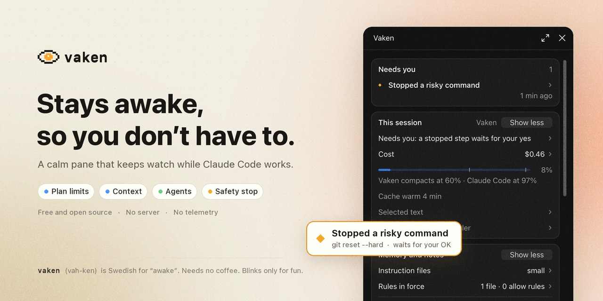
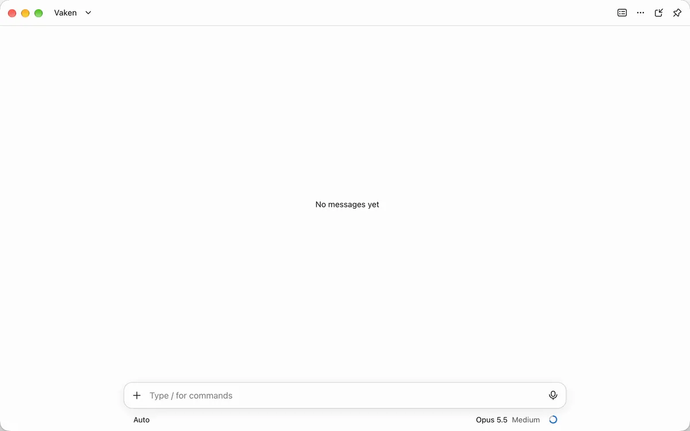
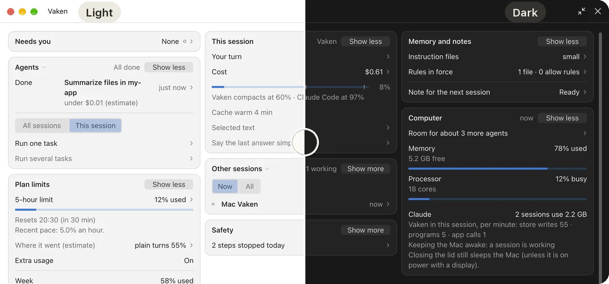
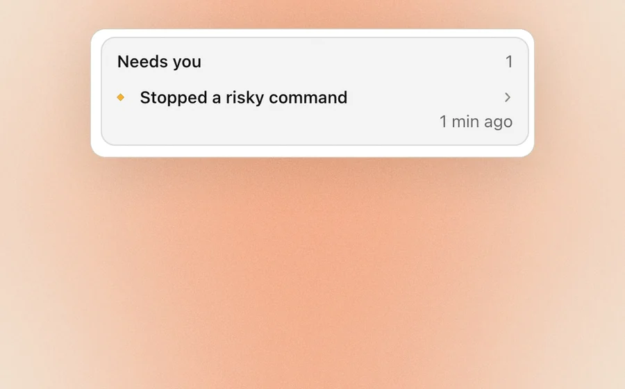
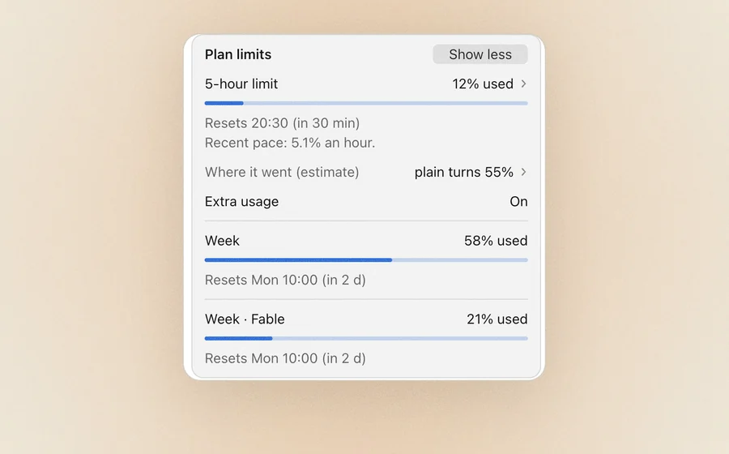
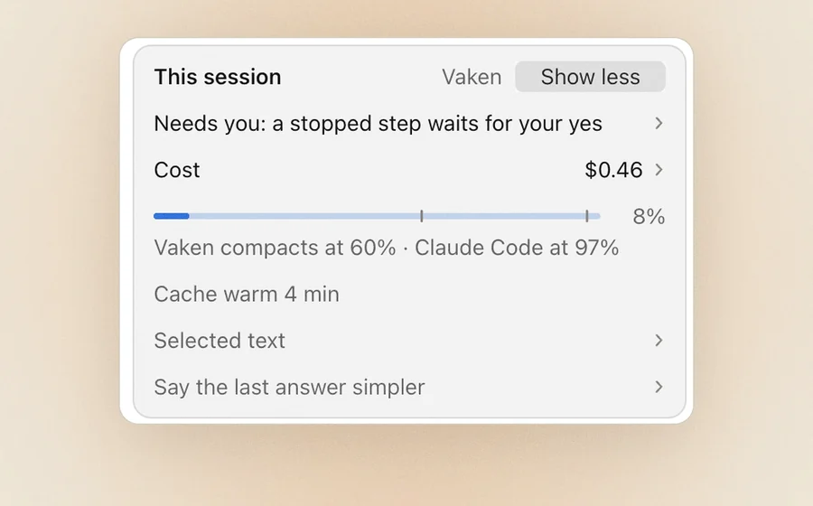
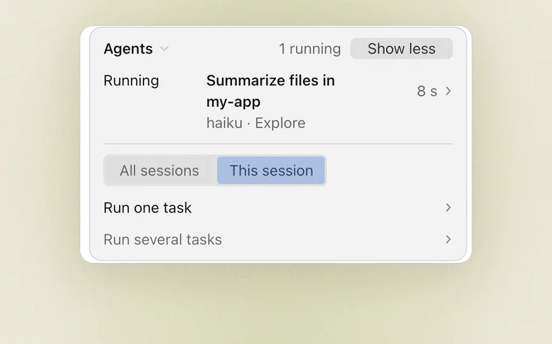
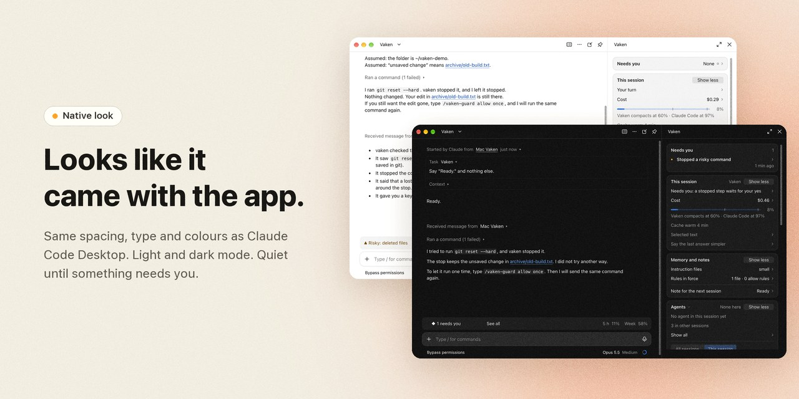
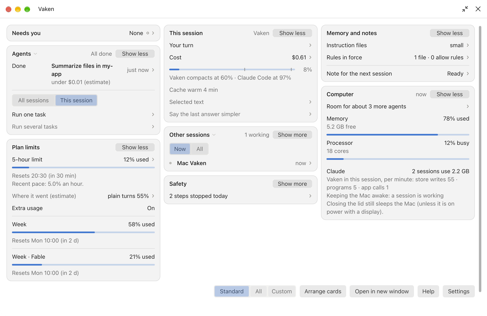

<div align="center">

<picture><source media="(prefers-color-scheme: dark)" srcset="docs/pictures/banner-dark.jpg"></picture>

# vaken: mission control for Claude Code

**The Claude Code Desktop plugin that tells you when a session needs you, warns before you hit your plan limit, and stops risky commands before they run.**

Free and open source (MIT) · No server, no telemetry · macOS and Windows 11 · Light and dark

[Install](#install) · [Features](#what-it-does) · [All 187 features](docs/features.md) · [How it works](#how-it-works-and-what-it-touches) · [FAQ](#faq)

<picture><source media="(prefers-color-scheme: dark)" srcset="docs/pictures/safety-dark.webp"></picture>

<sub>Claude tries <code>git reset --hard</code>. vaken stops it before it runs, and waits for you.</sub>



<sub>Light or dark: vaken follows your Mac.</sub>

</div>

## Install

```
claude plugin marketplace add johanmatsgard/vaken
claude plugin install vaken@vaken
```

> [!NOTE]
> Open a **new** session in Claude Code Desktop, then type `/vaken`. A plugin loads only when a session starts. The pane opens next to your chat; send one message and your figures appear.

Needs Claude Code Desktop on macOS or Windows 11. It does not run in the terminal alone. [More install details](#install-details).

## Who it is for

You run Claude Code for hours, often in several sessions at once. The same questions keep coming back:

| You wonder | vaken answers, without you looking |
|---|---|
| Is Claude waiting for me? | **Needs you**: one line, across all sessions |
| Will I hit my plan limit? | **Plan limits**: the reset time, and whether you run out at this pace |
| Is this chat getting too long and costly? | **This session**: how full the context is, and a cheap moment to compact |
| Is Claude about to break something? | **Safety stop**: risky commands wait for your OK |
| What are my other sessions and agents doing? | **Agents and sessions**: one list |

## What it does

<table>
<tr>
<td width="50%" valign="top">

<picture><source media="(prefers-color-scheme: dark)" srcset="docs/pictures/tile-needs-dark.webp"></picture>

### See what needs you, in every session

Questions, stopped steps and failed checks from all your Claude Code sessions, in one line at the top. Answer a question from the pane. vaken never says yes for you.

</td>
<td width="50%" valign="top">

<picture><source media="(prefers-color-scheme: dark)" srcset="docs/pictures/tile-limits-dark.webp"></picture>

### Track your Claude Code usage limits

Your 5-hour and weekly limits with their reset times, and a forecast: will you run out before the reset at the pace you work now? "Finish safely" lets Claude stop at a safe point first.

</td>
</tr>
<tr>
<td width="50%" valign="top">

<picture><source media="(prefers-color-scheme: dark)" srcset="docs/pictures/tile-context-dark.webp"></picture>

### Keep your context window healthy

A bar shows how full the chat is. Compacting means Claude summarises the chat so far; vaken can do it at a cheap moment, never mid-answer, and keeps your goal, branch and open questions.

</td>
<td width="50%" valign="top">

<picture><source media="(prefers-color-scheme: dark)" srcset="docs/pictures/tile-proof-dark.webp"></picture>

### "Done" means done

When Claude says the tests pass or the work is done, vaken checks that a real check ran. It also stops a step that keeps failing the same way.

</td>
</tr>
<tr>
<td width="50%" valign="top">

<picture><source media="(prefers-color-scheme: dark)" srcset="docs/pictures/tile-prompts-dark.webp"></picture>

### Better prompts, clearer answers

Spots a vague prompt and offers a sharper one, with no extra model call. Plain mode keeps answers short. Next-step buttons send the likely next ask in one press.

</td>
<td width="50%" valign="top">

<picture><source media="(prefers-color-scheme: dark)" srcset="docs/pictures/tile-agents-dark.webp"></picture>

### Every agent and session in one list

State, time and cost of every agent. A task runner gives a list of tasks to helpers, sized to your computer's free memory, each in its own folder copy.

</td>
</tr>
<tr>
<td width="50%" valign="top">

<picture><source media="(prefers-color-scheme: dark)" srcset="docs/pictures/tile-undo-dark.webp"></picture>

### Undo what Claude changed

A copy of each file before Claude changes it. Undo the last turn with a preview, or restore a named checkpoint. A handoff note carries your goal to the next session.

</td>
<td width="50%" valign="top">

<picture><source media="(prefers-color-scheme: dark)" srcset="docs/pictures/tile-away-dark.webp"></picture>

### Walk away. It keeps watch.

Away mode keeps safety strict and stops cost while you are gone. A Mac notification taps you when a session needs you. On your phone, answers get short and numbered.

</td>
</tr>
</table>

### What vaken catches

Small, calm alerts at the right moment. Each one is a real vaken alert.

<p align="center"><picture><source media="(prefers-color-scheme: dark)" srcset="docs/pictures/catches-dark.gif"></picture></p>

## 187 features, in 8 groups

Every group below opens to its full list. The [feature list page](docs/features.md) has all 187 features, one per line.

<details>
<summary><b>🛡️ Safety and proof</b>: Stops risky steps before they run, and checks that "done" is really done.</summary>


**Stops before it runs**

- Stops a destructive command (bulk delete, forced push, `git reset --hard`) before it runs, when Claude Code would not ask you first.
- Stops a step that would expose a secret. It names the kind of secret, never its value.
- Holds a database migration for your OK.
- `/vaken-pause` pauses every step that changes files, in one session. "Halt all" pauses every session.
- "Allow once" lets one stopped step through. "Keep stopped" keeps it stopped.
- Merge guard: a merge needs every check green, and vaken reads the exact command first.

**Warns you**

- Edits outside your project folders.
- A new package that is not real, very new, or a look-alike of a known one.
- Claude editing a test so that it passes.
- Real-world actions: sending, posting, paying, cloud changes.
- A step aimed at production by mistake (checks the environment name).
- Web text that tries to give Claude orders.
- Too many agents at once (agent cap).
- Many edits far from your goal.

**Stops loops**

- Loop breaker: a step that fails the same way 3 times is stopped until your next message.
- Start fresh with only the error, or one try with a stronger model.
- A note when the same file is edited again and again.
- Keep going until green: at most 3 fix rounds, then it stops and tells you.

**Proof, not promises**

- When Claude says "done" or "tests pass", vaken checks that a real check ran.
- Receipts: every check that ran, with its result.
- A definition of done per task, and a confidence score from evidence only.
- Review queue, riskiest change first, and an evidence pack for a review.
- Ship check: ready, or what blocks it.

**Explains**

- A step that was denied, and why.
- What left your computer this turn (outbox), and the last 50 commands with secrets masked.
- A judge for each command: safe, risky or blocked.
- What each plugin you installed can do.

</details>

<details>
<summary><b>🔔 Alerts: what needs you</b>: One line says what needs you, in every session. Then you can look away.</summary>


**Needs you**

- The top card lists every question, stopped step and failed check, from all your sessions.
- Answer another session's question from the pane. vaken never says yes for you.
- Says which session asks, when several run.
- "Quiet" after 10 minutes, "may be stuck" after 20, and a nudge for a stuck session.
- A command that runs for 10 minutes gets Stop or Keep waiting.
- Two sessions in one folder: a warning when they touch the same file or port.
- Is Claude down? A calm line when the Claude status page reports a problem.

**When you come back**

- Where was I: what waits for you after a break.
- A daily recap on your first prompt of the day, and open ends per project each morning.
- How long Claude waited for you, and what vaken saved you this week.

**Away and focus**

- Away mode: strict safety and a cost stop for a set time, then a digest of what finished, waited and cost.
- Focus for 50 minutes: only what needs you gets through.
- Mac notifications: a banner, a sound or a spoken line. Quiet hours.
- A status line under the prompt box.
- Calm by design: each event once, at most 6 notices an hour.

**On your phone**

- A three-line summary when your phone joins a session.
- Phone mode: short, numbered answers.
- One-word commands: `/ok`, `/no`, `/go`, `/st`, and a number menu on `/vaken`.
- `/vaken show`, `/vaken run` and `/vaken pic` send files and pictures to the phone.
- Tells Claude what a phone cannot do, so it sends files instead of asking you to open them.

</details>

<details>
<summary><b>📊 Usage, limits and cost</b>: See your Claude plan limits against the clock, and spend less of them.</summary>


**Plan limits**

- Your 5-hour and weekly limits, each with a bar and its reset time.
- "At this pace": says if you will run out before the reset.
- Finish safely: Claude stops at a safe point before a limit cuts it off.
- Continue by itself, or remind you, when a limit resets.
- Your daily share of the week, and a planner: does this job fit in what is left?

**Cost**

- Live cost and cost per hour, and where it went.
- A session and day budget, with Warn or Stop. Off by default.
- A cost estimate before a big job or a task run.
- What the last finished piece of work cost.

**Spend less**

- Long test, build and install logs reach Claude cut to the errors and the last lines.
- An unchanged file is not read again.
- Repeated reminders are skipped.
- Suggests a cheaper model or lower effort when the ask is small.
- A tip when a lookup helper could use a cheaper model.
- Warns that switching model mid-chat throws away the cheap cached part.
- Shows the size of your CLAUDE.md files and their repeated lines.
- Keeps the cache warm while you think. Off by default.

</details>

<details>
<summary><b>🧠 Context window and compacting</b>: Keeps long chats healthy. Compacting means Claude summarises the chat so far, so each answer re-reads less.</summary>


**See it**

- A bar shows how full this chat is, with a mark where Claude Code would compact by itself.
- Instruction files, memory and handoff, with their size.
- "Why not now?" says what holds compacting back.

**Compact at the right moment**

- Auto: compacts at a break or at 60% full, while the recent part is still cached, so it is cheap. Turn it on in the first setup or in Settings.
- Never mid-answer, never while an agent runs in front, never while a risky step waits, never while you type.
- Waits for a task boundary when helpers still run in the background.
- Compact now, with the same checks.

**Keep what matters**

- A handoff note and a checkpoint are saved first.
- Every summary keeps your goal, branch, open files, decisions and open questions.
- Checks after compacting that the summary kept them.
- Suggests a fresh chat when a new topic starts in a big one.

</details>

<details>
<summary><b>✍️ Better prompts and answers</b>: Sharper asks in, clearer answers out.</summary>


**Better asks**

- Spots a vague prompt and offers a sharper one, with no extra model call.
- Claude lists what it assumed before it starts.
- Suggests a plan first for work of several steps.
- Next-step buttons (Run tests, Commit, What changed) send the likely next ask in one press.
- Your own one-word quick actions, and suggestions as you type.
- Line up messages for a busy session.

**Clearer answers**

- Plain mode: short sentences and simple words.
- Say it simpler: the last answer again, in plain words.
- Answer shape: short, or a report.
- A failed step in plain words, with the first thing to try.
- What just happened: a short story of the last turn.
- A visible task list, a done-and-next close, and questions you can press.

**Learns how you work**

- A correction you repeat 3 times becomes a project rule, on your yes.
- A request you repeat can become a skill (a saved one-word instruction).
- Which skills you use and what they cost, with a search.
- Selected text: explain it, make it a task, or copy it.
- A decision log and a parking lot for side ideas.
- A read-only status tool that Claude itself can call.

</details>

<details>
<summary><b>🤖 Agents, sessions and the task runner</b>: Every agent and session in one list, and a task runner that knows your computer.</summary>


**All your sessions**

- Other sessions: your turn first, then working, then quiet. Pin the ones you care about.
- Clear session names from the first message.
- Resume a session by name, search across sessions, and a timeline.

**Agents**

- Every agent in all sessions: state, time and cost.
- Look inside a helper: its last 5 steps.
- Flags an agent with no progress for 10 minutes, and says when one finishes.

**Task runner**

- Give it a list of tasks; helpers do them, with a check after each.
- Each code task gets its own folder copy (a git worktree), so tasks do not collide.
- A reviewer note per task: good or not, and the main risk.
- Start a task from a goal in one row, with templates and starter agent files.
- Night run on mains power, inside plan and cost limits.

**Your computer**

- Memory, processor, battery and heat, and room for how many more helpers.
- Helpers sized to the free room.
- Keeps the Mac awake while work runs.
- A note before a port that is in use.
- Finds leftover programs, with a stop command for you to run.

**Git and pull requests**

- Pull requests: checks, conflicts, and Fix or Ship in one press.
- Fixes failing CI, at most 3 tries a day per branch.
- Merge step by step, each on your yes, in a sensible order.
- A digest of branch changes, and review by story.
- Removes merged folder copies, never forced.
- Warns when two sessions edit the same file.

</details>

<details>
<summary><b>↩️ Undo, memory and handoff</b>: Undo what Claude changed, and never lose the thread.</summary>


**Undo**

- A copy of each file before Claude changes it.
- Undo the last turn: preview, then yes.
- Copies before `git checkout`, `restore`, `stash` and `reset` too.
- Named checkpoints, with a preview before restore.

**Memory and handoff**

- A note for the next session: goal, branch, changed files, checks and open questions, each marked checked or not.
- The same facts as a file.
- What Claude remembers for this project, in plain words.
- Your instruction files and rules in force.
- A standup and story of the day, and a reflection: what was caught, and a rule to write down.

**Looks after itself**

- Clears its own old notes.
- A self-test after each start, and counts of its own failures.
- An export of its last 500 actions.

</details>

<details>
<summary><b>🎨 Look, views and settings</b>: Looks like it came with the app. Light and dark.</summary>


**Native look**

- Same spacing, type and colours as Claude Code Desktop.
- Light and dark mode, automatic.
- Eight accent colours.
- Reduced motion.

**Your layout**

- Three views: Standard, All and Custom.
- Glance, Short or All detail, and More or Less on each card.
- A card with a problem moves to the top.
- Drag cards to arrange them, and save named layouts.
- Columns on a wide screen, and the pane in its own window.
- New installs start small: five cards, the rest appear when they have something to say.

**Settings and help**

- Five setup questions the first time. Skip takes the recommended answers.
- Seven ready modes, from "Only alerts" to "Everything".
- A setting per project or per session.
- "Changed by you": every setting you changed, each with Undo.
- Help pages with search, and "What is this?" on every line.
- `/vaken-explain` says what any card or line means.
- Keyboard keys, and English or Swedish.

</details>


## Looks like it came with the app

Same spacing, type and colours as Claude Code Desktop. It follows light and dark mode by itself. On a wide screen, or in its own window, the cards sit side by side.

<p align="center"><picture><source media="(prefers-color-scheme: dark)" srcset="docs/pictures/panel-native-dark.jpg"></picture></p>

<p align="center"><picture><source media="(prefers-color-scheme: dark)" srcset="docs/pictures/wide-dark.png"></picture></p>

## vaken and usage trackers

Plain usage trackers and statuslines show your token use. vaken shows it too, and acts on it.

| | Usage trackers and statuslines | vaken |
|---|:-:|:-:|
| Plan limits and reset times | ✓ | ✓ |
| Forecast at your pace, and "Finish safely" | some | ✓ |
| Stops risky commands before they run | | ✓ |
| One line for what needs you, across sessions | | ✓ |
| Compacts at a cheap moment, keeps your goal | | ✓ |
| Checks that "tests pass" is true | | ✓ |
| Undo of Claude's file changes | | ✓ |
| Agents, sessions and a task runner | | ✓ |
| A native pane in Claude Code Desktop, light and dark | | ✓ |

## How it works, and what it touches

vaken is a Claude Code plugin. Its hooks run inside Claude Code on your computer, and the pane is drawn by Claude Code Desktop.

| | |
|---|---|
| **Sees** | Your prompts and the steps Claude takes, because it runs inside Claude Code. It keeps only short parts, listed in [PRIVACY.md](PRIVACY.md). |
| **Runs** | `git`, `gh` (if you have it), and system tools such as `ps` and `netstat`, to read facts. They only read. |
| **Sends** | Nothing to its authors. Two small web reads: a package name to the npm registry, and the public Claude status page. |
| **Never** | Says yes for you, writes your `settings.json`, or edits your source files. Undo restores a file only on your yes. |
| **Version** | 1.170.0. See the [releases](https://github.com/johanmatsgard/vaken/releases). |

The safety stop is a seat belt, not a sandbox: [SECURITY.md](SECURITY.md) says what it does and does not promise.

<details>
<summary><b>Everything vaken does by itself</b> (for reviewers)</summary>

vaken never answers "yes" for you, and it never writes permission rules into your settings. It only says "no" to a step, or acts when you press, unless you turn a feature on.

### Steps it can say no to

- **Risky steps (the safety check).** Before each step it looks for destructive commands, edits outside your folders, odd packages, outside actions, secrets and migrations. New install: it warns. In auto or bypass mode, where Claude Code would not ask you, a destructive command or a secret stops and waits for you. To only warn there too, press the choice "Warn (stops in auto mode)" yourself, once, in Settings > Safety > Risky commands and Secrets; it then reads "Warn only".
- **Pause and Allow once.** `/vaken-pause` stops every step that changes things. `/vaken-guard allow once` lets one stopped step through. Both only when you type them.
- **While away.** Careful stops risky steps while you are away. Off by default. Settings > Safety > While away.
- **Budget.** On Stop it says no to costly calls once the session or day budget is used up. Off by default. Settings > Money and plan > Budget.
- **Agent cap.** On Stop it says no to a new agent over your limit. New install: Warn, which never says no. Settings > Agents > Agent cap.
- **Loop breaker.** On Stop it says no to a step that keeps failing, until your next message. New install: Warn. Settings > Safety > Loop breaker.
- **Agent models.** It tells you when a lookup agent could use a cheaper model. It never changes the agent. Settings > Agents > Agent models.

### Output it makes shorter

- **Lean session.** On by default. Long install and test logs are cut short, and an unchanged file read again becomes one line. Errors and the last 40 lines are always kept. Settings > Money and plan > Lean session.

### Files it writes only on your press

- **Set up agents** writes agent files under `.claude/agents/` or a block in CLAUDE.md. Off by default: Settings > Prompts and memory > Set up agents.
- **Learn from you** offers to save a correction you repeat as one rule in the project's CLAUDE.md. It writes only when you press. `/vaken-settings teach.mode off` stops the offers.

### Things it runs

- **Compacting.** New install: Watch only. The This session card shows a good moment, and Compact now does it. Auto compacts by itself at a break or at 60% full, never while you type or work runs. The first-start question "Long chats" offers Auto, or set it in Settings > Money and plan > Compact by itself.
- **Task runner.** Nothing runs until you press Start. Then it starts agents for your task list. Only for the agents of a run you started, it sets each one's task, model and folder. After a plan limit it waits: press Go on on the Agents card. A run set to "After a plan limit: Go on" goes on by itself. Stop all on the Agents card, or `/vaken-tasks stop`, stops a run.
- **Night run.** Off by default. `/vaken-tasks night` runs the list unattended on mains power, keeps the Mac awake and turns on While away: Careful, then puts them back. It goes on after a limit by itself. Turn it on with `/vaken-settings night.mode on`.
- **After a limit.** New install: Remind, a note when the limit resets. Resume also sends "continue" for you, a few times a day at most. Settings > Money and plan > After a limit.
- **Keep session cheap.** Off by default. In a break it sends a short model call to keep the cache warm. Settings > Money and plan > Keep session cheap.
- **Keep Mac awake.** Off by default. Settings > Agents > Keep Mac awake.
- **Buttons.** Next steps, Ask, Compact now, Nudge, Remove copy and the others act only when you press them.
- **Background reads.** On timers it runs `git`, `gh`, `ps`, `pmset` and `netstat` and fetches the public Claude status page. They only read. Nothing is pushed or changed.

</details>


## Install details

1. Add the marketplace in a terminal:

   ```
   claude plugin marketplace add johanmatsgard/vaken
   ```

2. Install the plugin:

   ```
   claude plugin install vaken@vaken
   ```

3. Open a NEW session in Claude Code Desktop. A plugin loads only when a session starts.
4. Type `/vaken` in the chat box of the new session and press Return. The pane opens to the right of the chat. Send one message, and your figures appear.

On Windows 11, run the two commands in PowerShell, one at a time.

Requirements: Claude Code Desktop on macOS or Windows 11. A recent version of Claude Code Desktop is best (tested with 2.1.295 and later). Linux is not supported. `git` and the GitHub CLI `gh` are optional, for pull requests and merge.


## Commands

All commands start with `/vaken`. Type `/vaken-help` to see them all.

| Command | What it does |
|---|---|
| `/vaken` | Opens the pane. |
| `/vaken-usage` | Your plan limits, reset times, pace and cost. |
| `/vaken-compact` | Says what vaken thinks about compacting now. |
| `/vaken-guard` | Shows the safety check. Lets one stopped step through. |
| `/vaken-pause` | Pauses every change step in this session. |
| `/vaken-undo` | Lists changed files and restores them when you say yes. |
| `/vaken-away` | Away mode, and what happened while you were away. |
| `/vaken-tasks` | Runs a task list with agents. |

Seven more are in the [full list](docs/commands.md). What each card means is in the [guide](docs/guide.md).


## What it never does

- It never sends data to its authors. It has no server and no telemetry.
- It never changes your `settings.json`.
- It never stores your prompts or transcripts. It keeps a few short words, such as session titles and decision notes. See [PRIVACY.md](PRIVACY.md).
- It never writes the `CLAUDE.md` in your home folder.


## Your data

vaken stores data only on your computer. [PRIVACY.md](PRIVACY.md) lists every file and every setting. [SECURITY.md](SECURITY.md) says what the safety check does and does not promise.


## FAQ

<details>
<summary><b>Does it cost usage?</b></summary>

The default mode, "Recommended", makes no extra model calls. It adds short safety notes for Claude, for example when a step is risky, and a "what Claude keeps" note when vaken compacts a session. For bigger jobs it asks Claude for a visible task list, a short done and next close, and questions you can press, and plain mode asks for simple words. Auto compaction is on, and it saves usage: a compaction while the cache is warm costs less than the big context it replaces. A lean session saves usage too: a long test, build or install log reaches Claude cut to its errors and last lines. "Everything useful" adds checks that send Claude more text. The cache keeper is off by default and uses plan usage. You choose the mode in Settings.

</details>

<details>
<summary><b>Can it break or slow my session?</b></summary>

It stays fast. Its tests check the time of every view. If the safety check itself fails, it refuses steps that change things and lets steps that only read run. Type `/vaken-pause off` to resume after a pause.

</details>

<details>
<summary><b>Does it read my code or my prompts?</b></summary>

It runs inside Claude Code on your computer, so it sees your prompts and the steps Claude takes. It keeps only the short parts listed in [PRIVACY.md](PRIVACY.md).

</details>

<details>
<summary><b>Does it phone home?</b></summary>

No. vaken starts two requests: a lookup of a package name in the public npm registry, and a read of the public Claude status page, to say when Claude is down. Neither sends anything about you. Programs it runs, such as `gh`, use the network as they normally do.

</details>

<details>
<summary><b>Can I turn it off for one project?</b></summary>

Yes. Run `claude plugin disable vaken@vaken --scope project` in that project. You can also change a setting for one project with `/vaken-settings here <key> <value>`.

</details>

<details>
<summary><b>Nothing shows after <code>/vaken</code>.</b></summary>

Open a new session first. Then send one message, because the figures show after the first answer.

</details>

<details>
<summary><b>Will it change my files?</b></summary>

It does not edit your source files. It writes the files listed in [PRIVACY.md](PRIVACY.md), only when you ask or use the feature. Undo changes a file only when you say yes.

</details>

<details>
<summary><b>Is it free?</b></summary>

Yes. vaken is MIT licensed. Some optional features use your plan usage. See "Does it cost usage?".

</details>

<details>
<summary><b>Where is my data on Windows?</b></summary>

In the Claude Code plugin store, and in `%USERPROFILE%\.claude\cockpit`. See [PRIVACY.md](PRIVACY.md).

</details>

<details>
<summary><b>Does it work on Windows?</b></summary>

Yes, on Windows 11. Please [report](https://github.com/johanmatsgard/vaken/issues) what looks or works wrong.

</details>

<details>
<summary><b>How do I remove it?</b></summary>

See [UNINSTALL.md](docs/UNINSTALL.md). Delete the stored data first, then remove the plugin.

</details>


## Contributing

See [CONTRIBUTING.md](CONTRIBUTING.md). Small pull requests that change one thing are best.

Report a problem: open an issue at https://github.com/johanmatsgard/vaken/issues


## Made by


**Johan Matsgård** built vaken to run long Claude Code sessions calmly, without watching them. [GitHub](https://github.com/johanmatsgard) · [LinkedIn](https://www.linkedin.com/in/johanmatsgard)

<br clear="left">

If vaken saves you time, a ⭐ helps others find it.

## License

MIT. See [LICENSE](LICENSE). Not affiliated with Anthropic.

<p align="center"><picture><source media="(prefers-color-scheme: dark)" srcset="docs/pictures/footer-dark.gif"></picture></p>
