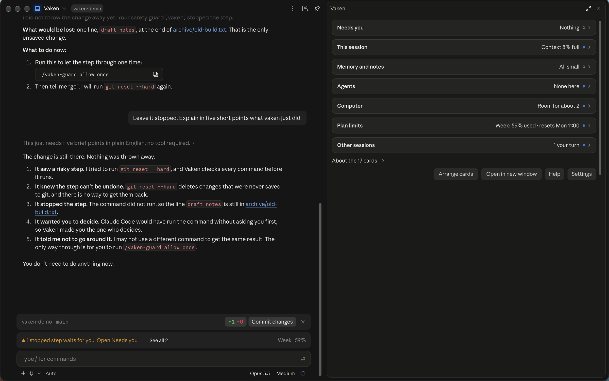
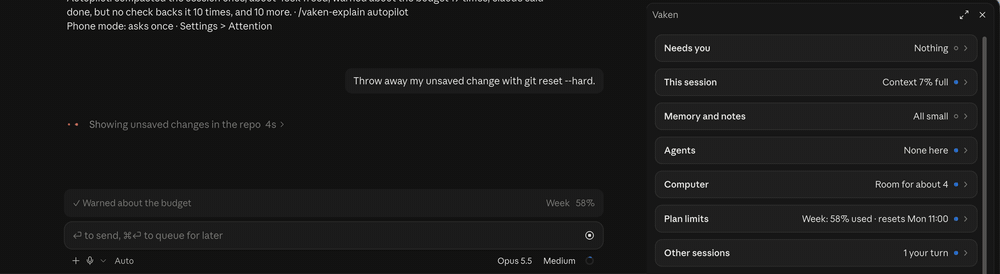
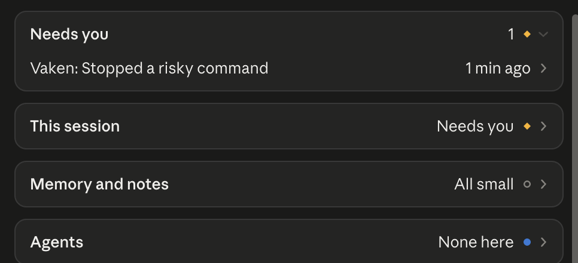
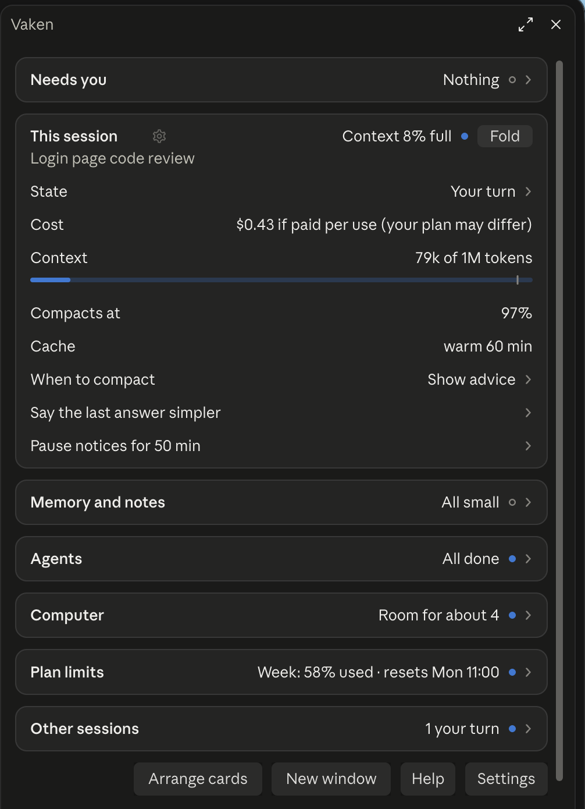
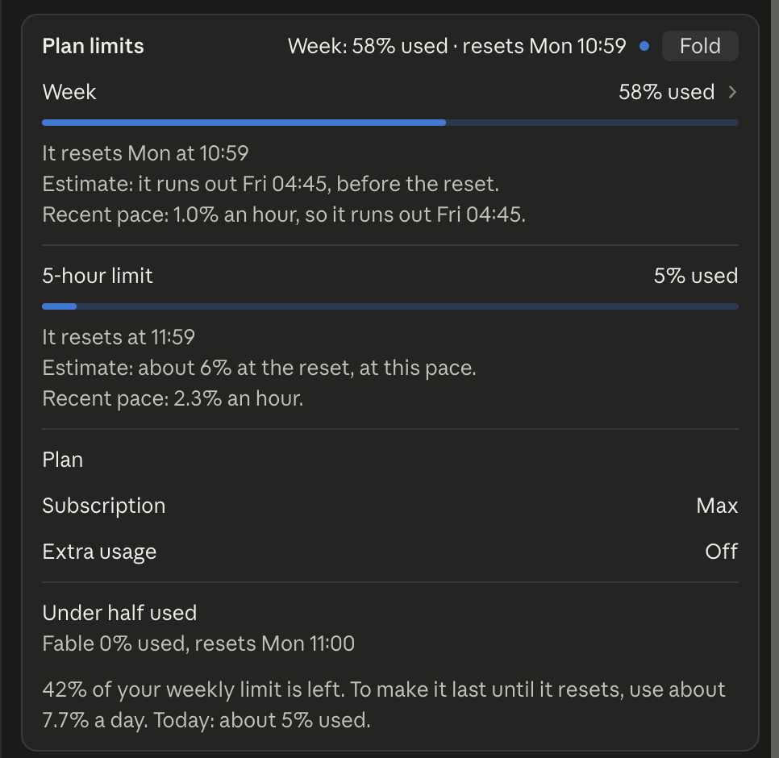
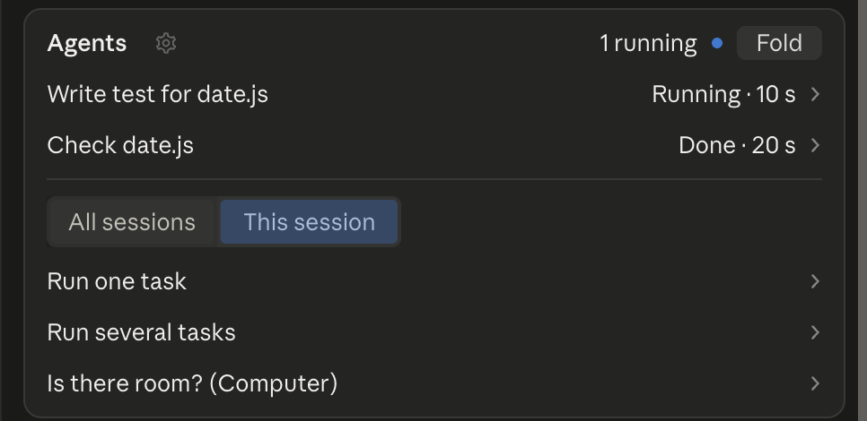
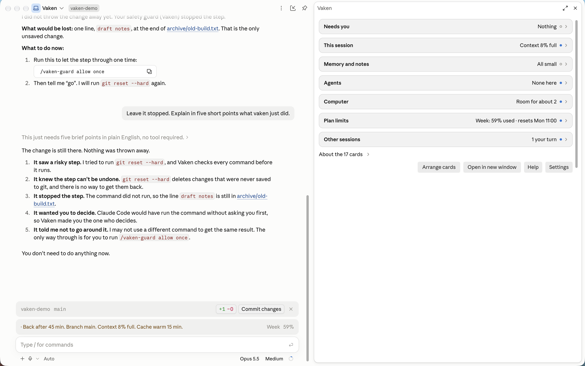
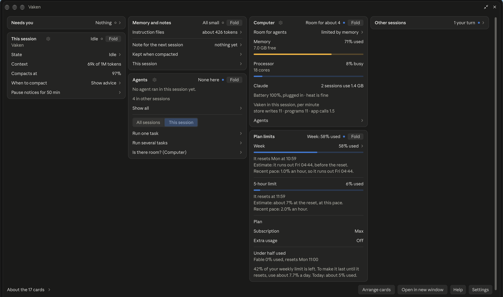

<div align="center">

# vaken

**See what needs you. Stay calm.**

A quiet side pane for Claude Code Desktop. It shows what needs you, what your plan has left, and what your agents do.



[](LICENSE)


```
claude plugin marketplace add johanmatsgard/vaken
claude plugin install vaken@vaken
```

Then open a NEW session and type `/vaken`.

[Install](#install) · [What you get](#what-you-get) · [Privacy](#what-it-never-does) · [FAQ](#faq)

</div>

## Why vaken

You run Claude Code for hours. Then the same four questions come back. vaken answers them in one pane next to your chat. You do not have to look. It tells you when something needs you.

| Your question | The card that answers it |
|---|---|
| Is Claude waiting for me? | Needs you |
| How much of my plan is left? | Plan limits |
| Is this session too full? | This session |
| What do my other sessions do? | Agents and Other sessions |

## A stop before a risky step

When Claude Code would not ask you first, a destructive command or a secret stops and waits for you. Press "Allow once" to let it through. When Claude Code asks you itself, vaken adds a warning. Your own choice in Settings always wins. "Off" turns the stop and the warning off for that kind of step.



Need a full stop? `/vaken-pause` pauses every change step. `/vaken-undo` restores changed files when you say yes.

## What you get

### One line tells you what needs you

The top card is always there. It lists a question from Claude, a step that waits for your OK, or a check that failed. When nothing waits, it says "Nothing".



### Know when to compact

The This session card shows how full the context is. A full context costs more usage, because Claude reads all of it again with each answer. vaken tells you when now is a good moment to compact, and when it is not, and why.



### Your plan limits, with the reset time

Your 5-hour limit and your weekly limit, each with a bar and a reset time. The limit that runs out first leads.



### Agents and other sessions in one list

See every agent in all your sessions: its state, its time and its cost. See what your other sessions do, and which one waits for you. Pin the ones you care about.



The Computer card says how many more agents your computer can run now. The Memory and notes card shows how big your instruction files, such as `CLAUDE.md`, are, and keeps a note for the next session.

## Also inside

<table>
<tr>
<td><b>"Done" checks.</b> When Claude says the tests pass or the work is done, vaken checks that a check really ran. It tells you if not.</td>
<td><b>Away mode.</b> Strict safety and a cost stop while you are gone, and a recap when you come back. The task runner can wait for a plan limit to reset.</td>
</tr>
<tr>
<td><b>Loop and budget stop.</b> Catches the same step failing again and again. Keeps a dollar budget per session and per day.</td>
<td><b>Wider safety.</b> Odd new packages, edits outside your folders, database migrations, secrets, and web text that tries to give Claude orders.</td>
</tr>
<tr>
<td><b>Undo.</b> A copy of each file before Claude changes it. Restore it with a command. You can also save checkpoints.</td>
<td><b>Two sessions, one folder.</b> Warns when another session edits the same file or uses the same port.</td>
</tr>
<tr>
<td><b>Daily recap and "Where was I".</b> One line on your first prompt of a day, and a card for what waits after a break.</td>
<td><b>Phone and Swedish.</b> Short, numbered answers when a phone joins. Menus and help pages in English or Swedish.</td>
</tr>
</table>

Most of these are on in the default mode, "Recommended". Away mode starts when you type `/vaken-away on`. All features are in the [guide](docs/guide.md).

## Made to feel native

vaken is built to look like part of Claude Code Desktop. It uses the same spacing, type and colours as the app. It works in light and dark mode.

- **Calm.** It speaks up only when something needs you.
- **Native.** It matches the app around it.

<p align="center">
<br>
<em>The same pane in light mode.</em>
</p>

## Calm by default, yours to arrange

The default Standard view shows Needs you and six cards. The All view shows Needs you and 17 more cards. The Custom view shows the cards you pick, in your order. On a wide screen the cards sit side by side. You can also open the pane in its own window.



## Install

1. Add the marketplace in a terminal:

   ```
   claude plugin marketplace add johanmatsgard/vaken
   ```

2. Install the plugin:

   ```
   claude plugin install vaken@vaken
   ```

3. Open a NEW session in Claude Code Desktop. A plugin loads only when a session starts.
4. Type `/vaken` in the chat box of the new session and press Return. The pane opens to the right of the chat. Send one message, and your figures appear.

On Windows 11, run the two commands in PowerShell, one at a time. Windows 11 is beta.

Requirements: Claude Code Desktop on macOS or Windows 11. A recent version of Claude Code Desktop is best (tested with 2.1.295 and later). Linux is not supported. `git` and the GitHub CLI `gh` are optional, for pull requests and merge.

## Commands

All commands start with `/vaken`. Type `/vaken-help` to see them all.

| Command | What it does |
|---|---|
| `/vaken` | Opens the pane. |
| `/vaken-usage` | Your plan limits, reset times, pace and cost. |
| `/vaken-compact` | Says if now is a good moment to compact. |
| `/vaken-guard` | Shows the safety check. Lets one stopped step through. |
| `/vaken-pause` | Pauses every change step in this session. |
| `/vaken-undo` | Lists changed files and restores them when you say yes. |
| `/vaken-away` | Away mode, and what happened while you were away. |
| `/vaken-tasks` | Runs a task list with agents. |

Seven more are in the [full list](docs/commands.md). What each card means is in the [guide](docs/guide.md).

## What it never does

- It never sends data to its authors. It has no server and no telemetry.
- It never changes your `settings.json`.
- It never stores your prompts or transcripts. It keeps a few short words, such as session titles and decision notes. See [PRIVACY.md](PRIVACY.md).
- It never writes the `CLAUDE.md` in your home folder.

## Your data

vaken stores data only on your computer. [PRIVACY.md](PRIVACY.md) lists every file and every setting. [SECURITY.md](SECURITY.md) says what the safety check does and does not promise.

## FAQ

**Does it cost usage?**
The default mode, "Recommended", makes no extra model calls. It adds short safety notes for Claude, for example when a step is risky, and a "what Claude keeps" note when a session is compacted. "Everything useful" adds checks that send Claude more text. The cache keeper is off by default and uses plan usage. You choose the mode in Settings.

**Can it break or slow my session?**
It stays fast. Its tests check the time of every view. If the safety check itself fails, it refuses steps that change things and lets steps that only read run. Type `/vaken-pause off` to resume after a pause.

**Does it read my code or my prompts?**
It runs inside Claude Code on your computer, so it sees your prompts and the steps Claude takes. It keeps only the short parts listed in [PRIVACY.md](PRIVACY.md).

**Does it phone home?**
No. The only request vaken starts is a lookup of a package name in the public npm registry. Programs it runs, such as `gh`, use the network as they normally do.

**Can I turn it off for one project?**
Yes. Run `claude plugin disable vaken@vaken --scope project` in that project. You can also change a setting for one project with `/vaken-settings here <key> <value>`.

**Nothing shows after `/vaken`.**
Open a new session first. Then send one message, because the figures show after the first answer.

**Will it change my files?**
It does not edit your source files. It writes the files listed in [PRIVACY.md](PRIVACY.md), only when you ask or use the feature. Undo changes a file only when you say yes.

**Is it free?**
Yes. vaken is MIT licensed. Some optional features use your plan usage. See "Does it cost usage?".

**Where is my data on Windows?**
In the Claude Code plugin store, and in `%USERPROFILE%\.claude\cockpit`. See [PRIVACY.md](PRIVACY.md).

**Does it work on Windows?**
Yes, on Windows 11, as a beta. Please [report](https://github.com/johanmatsgard/vaken/issues) what looks or works wrong.

**How do I remove it?**
See [UNINSTALL.md](docs/UNINSTALL.md). Delete the stored data first, then remove the plugin.

## Contributing

See [CONTRIBUTING.md](CONTRIBUTING.md). Small pull requests that change one thing are best.

Report a problem: open an issue at https://github.com/johanmatsgard/vaken/issues

## License

MIT. See [LICENSE](LICENSE).
